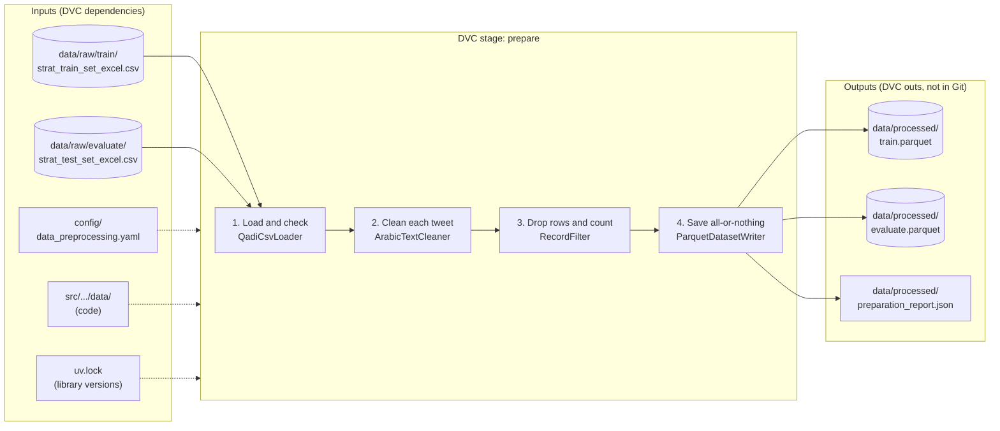
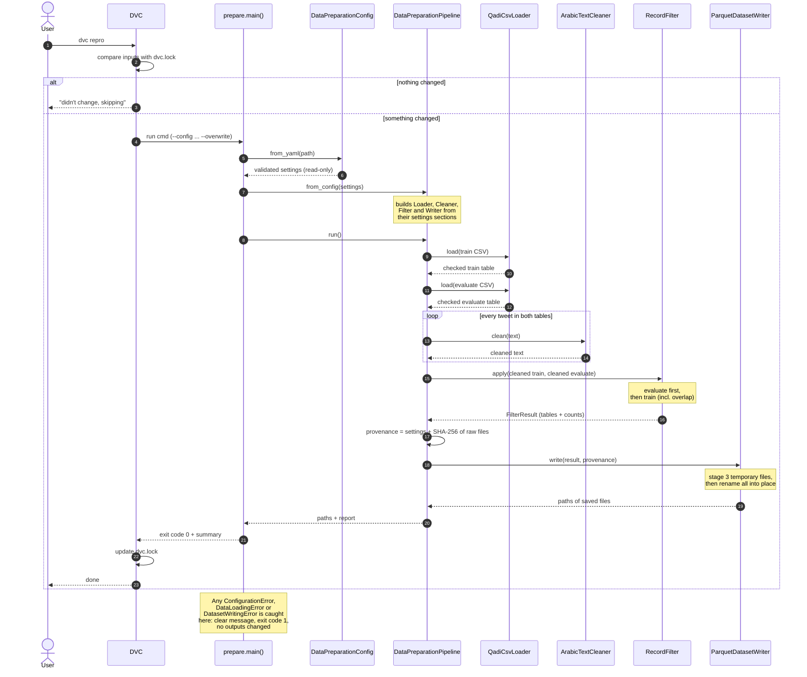
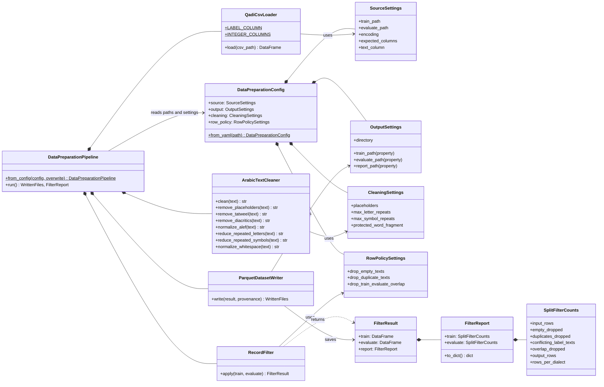
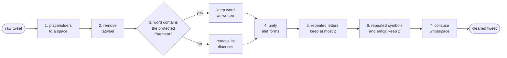
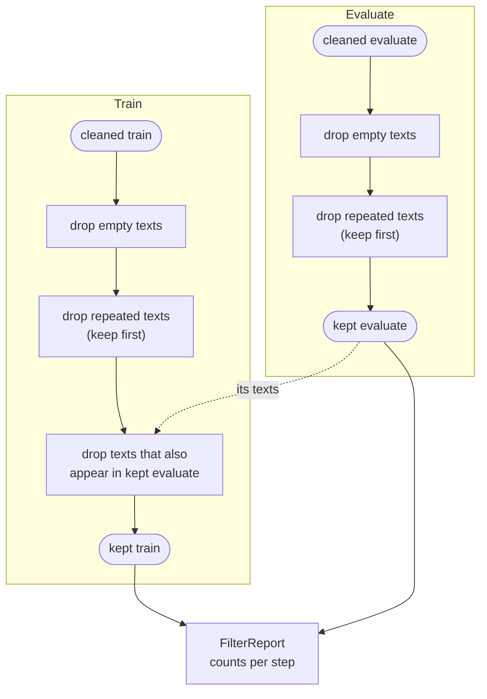

# Story: QADI data preparation

Status: **Implemented — awaiting review and PR (T10)**
Branch: `features/data-preparation`

## 1. Need and outcome

**Need.** The QADI tweets contain noise that carries no dialect signal: placeholder tokens, tatweel, diacritics, letter elongation, repeated emoji and punctuation, mixed alef forms and extra spaces. Models trained on this noise learn the wrong things.

**Outcome.** A reproducible DVC stage turns the raw train and evaluate CSVs into cleaned Parquet files with the same columns as the input, plus a JSON report of what was removed and how the outputs were produced.

## 2. Scope and non-goals

**In scope**
- Read `data/raw/train/strat_train_set_excel.csv` and `data/raw/evaluate/strat_test_set_excel.csv`.
- Apply the agreed cleaning rules (section 4) to the `text` column.
- Drop empty rows, duplicate texts and train/evaluate overlap (section 5).
- Write cleaned Parquet files and a report to `data/processed/`.
- Run as the DVC stage `prepare`.
- Unit and end-to-end tests built from synthetic examples only.

**Non-goals**
- No new train/validation/test split. The existing files are used as they are.
- No relabelling. `dialect` and `dialect_l_encoded` are kept unchanged.
- No tokenisation, model training or evaluation.
- No Hugging Face upload (separate, later story).
- No DVC remote. Data stays local for now.

## 3. Input data contract

| Column | Type | Notes |
|---|---|---|
| `id` | int64 | Tweet ID. Read as text, checked, then converted, so it is never rounded. |
| `dialect` | string | Country code, e.g. `SA`, `BH`, `LY`. Must not be blank. |
| `dialect_l_encoded` | int64 | Existing numeric label (0–17), kept as is. |
| `text` | string | Tweet text, already containing placeholders. Kept exactly as written (`NA`, `null` are not treated as missing). |

- Encoding: `utf-8-sig`.
- Exactly these four columns are required: missing **or** unexpected columns stop the run.
- A file with no data rows stops the run.
- Checked on the real files: train 449,033 rows, evaluate 9,164 rows, 18 dialects in each; all rows pass.

## 4. Text cleaning rules (applied in this order)

| # | Rule | Example |
|---|---|---|
| 1 | Replace placeholders `حسابشخصي`, `حسابشخصى`, `رابطويب` with a space | `مرحبارابطويبيا` → `مرحبا يا` |
| 2 | Remove tatweel `ـ` | `جـــميل` → `جميل` |
| 3 | Remove diacritics (U+064B–U+0652, U+0670), **except** in words containing `لله` | `مَجِيد` → `مجيد`; `اللَّه` unchanged |
| 4 | Unify alef: `أ إ آ ٱ` → `ا`. `ى ي ة ه ؤ ئ` unchanged | `أحمد` → `احمد` |
| 5 | Repeated letters (Arabic and Latin): keep at most 2. Digits never shortened | `هههههه` → `هه`, `sooo` → `soo` |
| 6 | Repeated symbols (punctuation, emoji): keep 1, including when separated by spaces. Digits excluded | `!!!` → `!`, `😂 😂 😂` → `😂`, `❤️❤️` → `❤️`, `2020` unchanged |
| 7 | Collapse all whitespace to single spaces and trim | `  x\n\ty ` → `x y` |

**Decisions**
- Rule 1 uses a space, not nothing, so a placeholder stuck to a word never glues two words together.
- Rule 3 protects any word whose diacritic-free form contains `لله` (covers الله، والله، بالله، لله، اللهم). Rare unrelated words containing `لله` also keep their diacritics; accepted as harmless.
- The two-word phrase `حساب شخصي` is real user text and is **kept**; only the joined placeholder is removed.
- Order matters: diacritics and tatweel go before repeats are counted (`هَهَهَه` → `هه`); whitespace is last.
- Cleaning is idempotent: cleaning twice gives the same result as once.

**Known limitation:** emoji built from several joined parts (family emoji, flags) may not collapse under rule 6. Emoji with a skin tone or variation selector do collapse.

## 5. Row policy

1. Drop rows whose cleaned `text` is empty.
2. Drop duplicate cleaned texts within each file, keeping the first occurrence.
3. Drop train rows whose cleaned text also appears in evaluate (**confirmed**). Evaluate rows are never dropped for this reason.
4. Report texts that appear with more than one dialect label (`conflicting_label_texts`). They are still de-duplicated by rule 2.

Each step can be switched off in `row_policy` in the settings file.

## 6. Output contract

| File | Content |
|---|---|
| `data/processed/train.parquet` | kept train rows, same four columns and types |
| `data/processed/evaluate.parquet` | kept evaluate rows, same four columns and types |
| `data/processed/preparation_report.json` | `counts` per file (input, empty, duplicates, conflicting labels, overlap, output, rows per dialect) and `provenance` (settings used, SHA-256 of each raw file) |

- All three files are written together: on failure, nothing is changed and no partial file is left.
- Existing outputs are not overwritten unless `--overwrite` is given (the DVC stage passes it).
- No timestamp is stored, so identical inputs give byte-identical outputs.

### Results on the real corpus (`dvc repro`, 2026-11-07)

| | Input rows | Empty | Duplicates | Overlap with evaluate | Output rows | Conflicting-label texts |
|---|---|---|---|---|---|---|
| train | 449,033 | 0 | 153 | 3 | **448,877** | 125 |
| evaluate | 9,164 | 0 | 0 | 0 | **9,164** | 0 |

- 156 train rows removed (0.03%); evaluate unchanged.
- 125 of the repeated train texts carried different dialect labels, so most duplicates are short phrases shared across dialects rather than copied tweets. The first occurrence's label is kept; see follow-ups.
- Cleaning all 458,197 tweets took about 30 seconds; the whole stage about 35 seconds.

## 7. Architecture (as built)

```
config/data_preprocessing.yaml
        │  DataPreparationConfig.from_yaml
        ▼
DataPreparationConfig ── source / output / cleaning / row_policy
        │
        ▼  DataPreparationPipeline.from_config
DataPreparationPipeline.run()
   ① QadiCsvLoader.load            raw CSV → checked DataFrame
   ② ArabicTextCleaner.clean       one tweet → cleaned tweet
   ③ RecordFilter.apply            drop rows → FilterResult (tables + FilterReport)
   ④ ParquetDatasetWriter.write    Parquet ×2 + JSON report
```

| Module | Class | Responsibility |
|---|---|---|
| `config.py` | `DataPreparationConfig` (+ 4 settings groups) | Load and validate settings; reject typos and invalid values |
| `loader.py` | `QadiCsvLoader` | Read one raw CSV and enforce the input contract |
| `cleaner.py` | `ArabicTextCleaner` | Apply rules 1–7 to one string |
| `record_filter.py` | `RecordFilter`, `FilterReport`, `FilterResult` | Apply the row policy and count removals |
| `writer.py` | `ParquetDatasetWriter` | Save outputs all-or-nothing, never overwrite by accident |
| `pipeline.py` | `DataPreparationPipeline` | Connect the parts in order; record provenance |
| `prepare.py` | `main()` | Command-line entry point; exit code 0/1 |

Each part receives its settings or collaborators (dependency injection). Each error type tells you where to look: `ConfigurationError` (settings), `DataLoadingError` (raw data), `DatasetWritingError` (outputs).

### 7.1 End to end: inputs, steps and outputs

What goes in, what each step does, and what comes out. The dashed box is what DVC watches: if any input changes, `dvc repro` runs the stage again.



### 7.2 Sequence: who calls whom, in what order

One run of `uv run dvc repro` (or the `prepare` command). Time goes from top to bottom.



### 7.3 Classes: how the parts are connected

Solid diamonds (`*--`) mean "is built from / holds"; plain arrows (`-->`) mean "uses"; dashed arrows (`..>`) mean "creates or returns".



### 7.4 What happens to one tweet

`ArabicTextCleaner.clean()` passes the text through the seven rules in this order. Each rule is its own method and can be called on its own.



### 7.5 What happens to the rows

`RecordFilter.apply()` filters evaluate first, so that train is compared against the final evaluate texts. Each step can be switched off in `row_policy`.



## 8. Acceptance criteria

| # | Criterion | Evidence | Status |
|---|---|---|---|
| 1 | Each cleaning rule has passing unit tests | `tests/data/test_cleaner.py` | ✅ |
| 2 | Cleaning is idempotent | `test_cleaning_twice_gives_the_same_result_as_once` | ✅ |
| 3 | Outputs have exactly the four columns; labels unchanged | `test_pipeline.py` | ✅ |
| 4 | No empty or duplicate texts in outputs | `test_record_filter.py` | ✅ |
| 5 | No cleaned train text appears in evaluate | `test_pipeline.py`, `test_record_filter.py` | ✅ |
| 6 | Raw files byte-for-byte unchanged | `test_raw_files_are_byte_for_byte_unchanged` | ✅ |
| 7 | `uv run pytest` passes | 208 passed; `ruff check` and `mypy --strict` clean | ✅ |
| 8 | README documents command, outputs and layout | README "Data preparation" section | ✅ |

## 9. Tasks

| # | Task | Status |
|---|---|---|
| T1 | Approve story | ✅ |
| T2 | Settings file + `DataPreparationConfig` + tests | ✅ |
| T3 | `QadiCsvLoader` + tests | ✅ |
| T4 | `ArabicTextCleaner` (rules 1–7, `clean`) + tests | ✅ |
| T5 | `RecordFilter` + tests | ✅ |
| T6 | `ParquetDatasetWriter` + tests | ✅ |
| T7 | `DataPreparationPipeline` + `prepare` command + end-to-end tests | ✅ |
| T8 | `dvc.yaml` stage `prepare`; `dvc repro` run; `dvc status` up to date | ✅ |
| T9 | README and docs | ✅ |
| T10 | Review, fixes, commit, push, PR (each approved separately) | ⏳ |

## 10. Process notes and review

- T4 rules 4–7 and `clean()` were implemented together at the user's request, instead of one unit per pause. They were tested together (rules 1–7, `clean()`, idempotence) before approval.
- Review findings fixed in this story: unknown `encoding` names are rejected when settings load; output-folder creation errors are reported as `DatasetWritingError`; the label column name is defined once (`QadiCsvLoader.LABEL_COLUMN`); lint style fixes; `ruff` and `mypy` configured as dev tools.
- Check configuration (`pyproject.toml`): `ruff` rules E, F, W, B, I, SIM, N, UP, RUF with line length 120; `RUF001`–`RUF003` ignored because they flag Arabic letters; `notebooks/` excluded because exploration is kept separate from the package. `mypy` runs in strict mode on `src/`. How to run them is in the README "Checks" section.

## 11. Open follow-ups (outside this story)

- Review the 125 texts with conflicting labels and decide whether to drop them entirely instead of keeping the first label.
- Publish `data/processed/` to Hugging Face (separate story; check QADI licence first).
- Add a DVC remote before sharing the project.
- Update the project instructions to say Python ≥ 3.11 (matches `pyproject.toml`).
- Invisible characters (zero-width space, RTL/LTR marks, BOM): measure on the real data, then decide whether to add a cleaning rule. Texts differing only by these are not treated as duplicates today.
- Duplicate tweet IDs (within a file, and across train/evaluate) are not checked; consider reporting them.